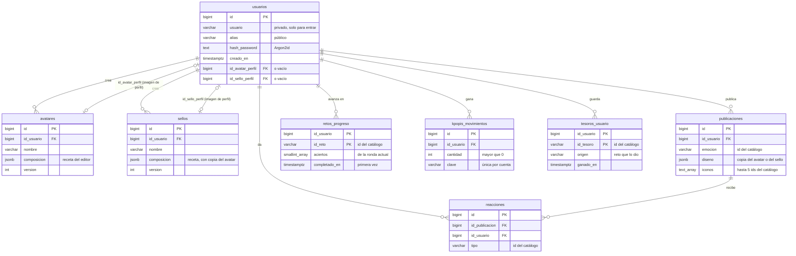

# Modelo de datos de K-ME

Estado a 25/11/2026, con las migraciones `001` a `009` aplicadas (`app/db/migrations/`). Base de datos: PostgreSQL. Este documento explica **qué se guarda, dónde y por qué**. Las decisiones que se citan (D…) están en `BITACORA_KME.md`, y el detalle técnico, en `docs/TECH_SPEC.md`.

## La idea en una frase

Todo lo que crea una fan es **de su cuenta**: se guarda en el servidor con su `id_usuario`, se recupera desde cualquier navegador, y ninguna otra cuenta lo puede ver ni cambiar, salvo lo que ella publica en el muro de Connect.

## Diagrama

Además está la tabla `sesiones` (las sesiones abiertas, la gestiona `connect-pg-simple`) y `schema_migrations` (qué migraciones se han aplicado). No se relacionan con las demás por clave foránea.

## Las tablas, una a una

| Tabla | Qué guarda | Migración | Reglas importantes |
| --- | --- | --- | --- |
| `usuarios` | Las cuentas: usuario privado, alias público, hash de la contraseña y la imagen de perfil. | 001, 003, 007 | Usuario y alias únicos sin distinguir mayúsculas (D020). Nunca se guarda la contraseña, solo su hash Argon2id. |
| `sesiones` | Las sesiones abiertas (24 h, o 7 días con «Mantener sesión abierta»). | 002 | La cookie solo lleva el identificador; los datos están en el servidor. |
| `avatares` | Los avatares de Avatar Studio, como **receta** (qué pieza y qué color en cada capa), no como imagen. | 006 | Hasta 20 por cuenta. `version` evita que dos pestañas se pisen al guardar (409). La receta se valida con el catálogo del editor (`kme-receta.js`). |
| `sellos` | Los sellos de Sello Studio, también como receta. | 005 | Hasta 20 por cuenta. Si llevan avatar, guardan una **copia** de su receta (D041, T034). |
| `publicaciones` | El muro de Connect: una emoción, el diseño que la acompaña y el mensaje con iconos. | 004, 008 | Sin texto libre. El diseño es una **copia** (D060). De 0 a 5 iconos, comprobado también por la base de datos. |
| `reacciones` | Cada pulsación de una reacción. | 004 | Hasta 10 del mismo tipo por persona y publicación (lo comprueba el servidor). |
| `retos_progreso` | El progreso de cada cuenta en cada reto (HANGUL LIVE 001). | 009 | `aciertos`: preguntas acertadas en la ronda actual; al acertarlas todas, la ronda se vacía para poder repetirla. `completado_en`: la primera vez. |
| `kpopis_movimientos` | Los Kpopis ganados. El saldo es la suma. | 009 | `UNIQUE (id_usuario, clave)`: una recompensa nunca se cobra dos veces, ni con dos respuestas a la vez. De momento solo se gana (`cantidad > 0`); el canje llegará con su propia migración. |
| `tesoros_usuario` | Los tesoros ganados («Mis tesoros»). | 009 | Cada tesoro, una vez por cuenta (clave primaria doble). |

## Tres ideas que explican el diseño

### 1. Copia o referencia

- **Referencia** (la imagen de perfil, D055): `usuarios` apunta al avatar o al sello con una clave foránea. El perfil enseña siempre la versión actual. Si se borra el avatar, la base de datos deja el perfil vacío (`ON DELETE SET NULL`).
- **Copia** (las publicaciones y los sellos con avatar, D060, T034): se guarda la receta tal como estaba. Si después se edita o se borra el avatar, la publicación y el sello no cambian, como una photocard ya impresa.

### 2. En la base de datos, ids; en los catálogos, los textos y los dibujos

Las emociones, las reacciones, los iconos, las palabras en hangul, los retos y los tesoros están en `app/src/catalogos/`. La base de datos guarda solo su id (`'feliz'`, `'hangul-live-001'`, `'luz-hangul-001'`…). Así se puede corregir un texto o cambiar un dibujo sin tocar los datos guardados, y el servidor rechaza cualquier id que no esté en el catálogo.

### 3. Cada consulta filtra por la cuenta de la sesión

Las consultas de los modelos (`app/src/models/`) usan siempre `WHERE id_usuario = $1` con el id de la sesión, nunca uno que llegue del formulario o de la URL. Un avatar o un sello de otra cuenta «no existe» (404). Cada recurso tiene su test de «otra cuenta no puede». Al borrar una cuenta, se borra también todo lo suyo (`ON DELETE CASCADE`).

## Qué no se guarda

- Ningún correo, nombre real ni foto de una persona (D018).
- Ningún texto libre en Connect ni en los sellos: todo sale de listas cerradas (D038, D041).
- Ninguna imagen generada: los avatares, los sellos y las photocards se dibujan a partir de su receta cada vez que hacen falta.
