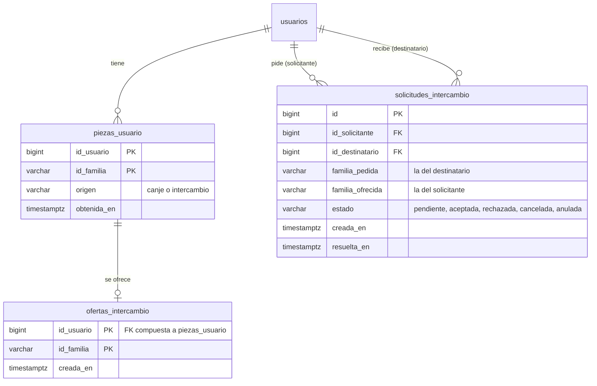

# Intercambios · propuesta de MVP (P030)

**[PROPUESTA, sin construir]** Retoma P017 (intercambiar piezas entre fans) y P018 (objetos distintos para cada fan). En el plan D054 los intercambios quedaban para después del 1/12; esta propuesta dice si caben antes de congelar el código y con qué reglas. Nada se construye hasta que la autora cierre las reglas del apartado 4.

## 1. ¿Es viable?

Sí. El modelo actual ya sirve: la propiedad está en `piezas_usuario`, una fila por cuenta y familia. Un intercambio es mover dos filas de dueño dentro de una transacción, como ya hace el canje.

- **Lo nuevo va aparte:** una migración, dos tablas y unas páginas nuevas.
- **Solo toca tres cosas que ya funcionan, y poco** (apartado 6): la clave del canje, la regla al guardar un avatar y duplicar.
- **Esfuerzo:** unas 6 a 8 horas del asistente, con tests: un día.

**Calendario:**
- **(a) Jueves 26.** Entra en la prueba del viernes. Si el viernes algo falla, se oculta con un interruptor (se quitan el enlace y las rutas) y la demo no se toca.
- **(b) Después del 1/12,** como estaba previsto.

**Recomendación:** (a), solo si las reglas quedan cerradas el jueves por la mañana. Antes, conviene subir lo pendiente, para tener un punto limpio al que volver.

## 2. Alcance mínimo

- **Qué se intercambia:** solo las familias de **canje** de Colección «K» (hoy, Top Destello, Chaqueta Denim Collage y las seis de Encore), con todas sus variantes de cuerpo.
- **Qué no:**
  - las especiales gratis (lotes 01, 02 y 05, y Spotlight), porque todas las cuentas las tienen;
  - los tesoros de eventos, como Luz Hangul 001.
- **Ofrecer:** cada fan marca qué piezas suyas ofrece («Mis piezas para intercambiar»). Nadie ve el inventario de nadie, solo lo que se ofrece.
- **Buscar:** en el catálogo de una pieza se ven los **alias** de quienes la ofrecen.
- **Pedir:** una pieza por otra tuya. Sin chat ni texto libre.
- **Responder:** quien la recibe **acepta o rechaza**; quien la pidió puede **cancelar** mientras esté pendiente.
- **Intercambio:** solo al aceptar, cada una entrega su pieza y recibe la otra.
- **Dónde:** dentro de Colección «K», con un enlace «Intercambios» junto a «Canjear Kpopis». No hace falta tocar el menú de la cabecera, que en el móvil ya va justo.

## 3. Modelo de datos (migración 011)

- **Ofertas:** `ofertas_intercambio` apunta a `piezas_usuario` con una clave foránea compuesta y `ON DELETE CASCADE`. Si la pieza deja de ser tuya, la oferta desaparece sola.
- **Solicitudes:** `solicitudes_intercambio` es también el **historial** de intercambios (las aceptadas se conservan). El historial de canjes sigue en `kpopis_movimientos`.
- **Comprobaciones en la base de datos:** el estado, solo de una lista; nadie se pide a sí mismo; las dos familias, distintas. Un índice único parcial impide dos solicitudes pendientes iguales (mismo solicitante, destinatario y pieza pedida).
- **No hacen falta ejemplares.** Cada cuenta tiene una familia como mucho una vez, y el intercambio mueve familias. Así nadie tiene dos iguales y no hay copias que contar.

## 4. Reglas que hay que cerrar (propuesta concreta)

1. **Editar un avatar antiguo que lleva una pieza entregada** (la propuesta de la autora):
   - la pieza se conserva **solo en ese mismo avatar** mientras no se quite;
   - el servidor lo decide comparando con la versión guardada de ese avatar: una pieza que ya no es tuya solo se acepta si ya estaba en lo guardado;
   - si la quitas y guardas, ya no puedes volver a ponerla sin conseguirla otra vez;
   - en el editor, la pieza se ve (y se puede quitar) solo al editar ese avatar.
2. **Duplicar o «Guardar como copia»:** el servidor exige que todas las piezas de canje sean tuyas, así que una entregada no pasa a la copia. Duplicar responde: «Este avatar lleva una pieza que ya no es tuya: quítala antes de duplicarlo». «Guardar como copia» ya lo rechaza hoy.
3. **Usar un avatar antiguo tal como está** (imagen de perfil, Connect, sello con su copia) **sí se permite**: no es una creación nueva del avatar, solo se enseña. *A confirmar.*
4. **Volver a conseguir una familia entregada:**
   - por otro intercambio o por canje, pagando otra vez;
   - el canje sigue impidiendo pagarla dos veces mientras la tienes;
   - la clave pasa a numerarse: la primera sigue siendo `canje:<familia>` (los datos de hoy no cambian) y las siguientes, `canje:<familia>:2`, `:3`…
5. **Solicitudes pendientes de una pieza que se entrega por otro intercambio:**
   - al aceptar uno, se **anulan** en la misma transacción las demás pendientes que pedían u ofrecían cualquiera de las dos piezas de esas dos cuentas;
   - además, aceptar vuelve a comprobarlo todo y, si una pieza ya no está, la solicitud queda anulada con un aviso.
6. **Recibir una pieza que ya tienes:**
   - no se puede pedir una pieza que ya es tuya, ni ofrecer una que la otra persona ya tiene;
   - el formulario solo enseña opciones válidas;
   - el servidor lo comprueba al pedir y otra vez al aceptar; si ha cambiado entretanto, anula.
7. **Límite contra el abuso:**
   - como mucho **5 solicitudes pendientes enviadas** por cuenta;
   - una sola pendiente por persona y pieza pedida;
   - tras un rechazo, no se puede pedir lo mismo a la misma persona en 24 h.

## 5. Seguridad y concurrencia

- **Todo en el servidor:**
  - con la sesión (`requiereSesion`) y el CSRF en cada formulario, y SQL parametrizado;
  - solo el destinatario acepta o rechaza, y solo el solicitante cancela;
  - otra cuenta recibe 404.
- **Aceptar, en una transacción:**
  1. bloquea la solicitud (`FOR UPDATE`) y comprueba que sigue pendiente y es tuya;
  2. bloquea las dos cuentas en orden de id, para que dos intercambios a la vez no se crucen ni se bloqueen;
  3. comprueba la propiedad de las dos piezas y que ninguna cuenta tenga ya la que recibe;
  4. mueve las dos piezas y cambia el estado a «aceptada»;
  5. anula las pendientes afectadas.

  O todo o nada: sin cambios a medias.
- **Aceptar dos veces** (o aceptar y cancelar a la vez): la segunda ve que la solicitud ya no está pendiente y no hace nada.
- **Los avatares y sellos guardados no se tocan nunca.**

## 6. Impacto sobre lo que ya funciona

| Parte | Cambio | Riesgo |
| --- | --- | --- |
| Canje (`canjeModel`, «Mis Kpopis») | Clave numerada al volver a canjear; el concepto ignora el número. | Bajo: los 12 tests del canje siguen. |
| Guardar un avatar (`avatarService.guardar`) | Acepta una pieza que ya no es tuya solo si ya estaba guardada en ese avatar. | Medio: el centro de la regla 1, con tests propios. |
| Duplicar | Comprueba la propiedad. | Bajo. |
| Editor (`avatar-editor`) | Las piezas bloqueadas no incluyen las que lleva el avatar que se edita. | Bajo. |
| Nuevo | Migración 011, modelo, servicio, controlador, 2 o 3 vistas, rutas y un enlace en Colección «K». | Aislado. |

## 7. Cómo se haría (si se aprueba)

- **TDD:** primero los tests en rojo y luego el código. Cuentas `test_…`/`fan_…` y unos 25 tests nuevos:
  - el recorrido con dos cuentas: ofrecer, buscar, pedir, aceptar y que cada una tenga la otra pieza;
  - rechazar, cancelar, aceptar dos veces, aceptar y cancelar a la vez;
  - dos aceptaciones simultáneas que entregan la misma pieza (solo una gana);
  - las anulaciones, el límite, otra cuenta (404) y CSRF;
  - los avatares guardados intactos, editar con la pieza entregada (se conserva, se quita y no vuelve), duplicar (403) y crear nuevo (403);
  - volver a canjear (cobra otra vez).
- **Después, en Chrome sin ventana:** el recorrido con dos cuentas.
- **Después, la autora en su navegador.**
- **En la bitácora,** separando lo implementado, lo probado con tests y lo revisado en el navegador.

## 8. Lo que necesita decidir la autora

1. Si confirma las reglas 1 a 7, sobre todo la 1 (su propuesta) y la 3.
2. ¿Jueves 26, con el interruptor (a), o después del 1/12 (b)?
3. Subir antes lo pendiente, para empezar desde un punto limpio.
